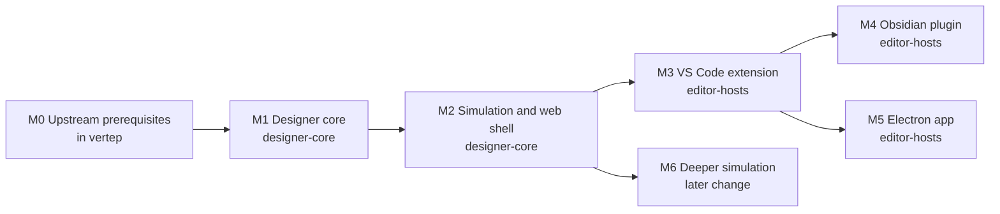

# Roadmap

vertepnyk is delivered in seven milestones: upstream work in vertep first, then the shared designer core, then one host at a time, then deeper simulation.

## M0 Upstream prerequisites

Work in vertep that vertepnyk needs: the reserved layout namespace in its SCXML and YAML readers, and `@vertep/web` and `@vertep/dm-ecma` published to npm.

- precedes:: [[roadmap#M1 Designer core]]

Tasks 0.1 to 0.4 of the OpenSpec change `designer-core`; the work itself lands in vertep as its own change.

## M1 Designer core

Chart document, layout, canvas and inspector: a chart can be opened, edited and saved visually.

- precedes:: [[roadmap#M2 Simulation and web shell]]

## M2 Simulation and web shell

Validation and simulation on vertep's interpreter, with time travel, in a browser web shell.

- precedes:: [[roadmap#M3 VS Code extension]]
- precedes:: [[roadmap#M6 Deeper simulation]]

## M3 VS Code extension

The host bridge and the VS Code custom editor, published to the Marketplace and Open VSX.

- precedes:: [[roadmap#M4 Obsidian plugin]]
- precedes:: [[roadmap#M5 Electron app]]

## M4 Obsidian plugin

The Obsidian file view, code-block charts and embeds, published as a community plugin.

## M5 Electron app

The standalone desktop app for macOS, Windows and Linux on GitHub Releases.

## M6 Deeper simulation

A virtual clock for delayed events, live context editing and recorded scenarios that replay as code-free tests; each needs an upstream API in vertep (a clock option, a context setter).
