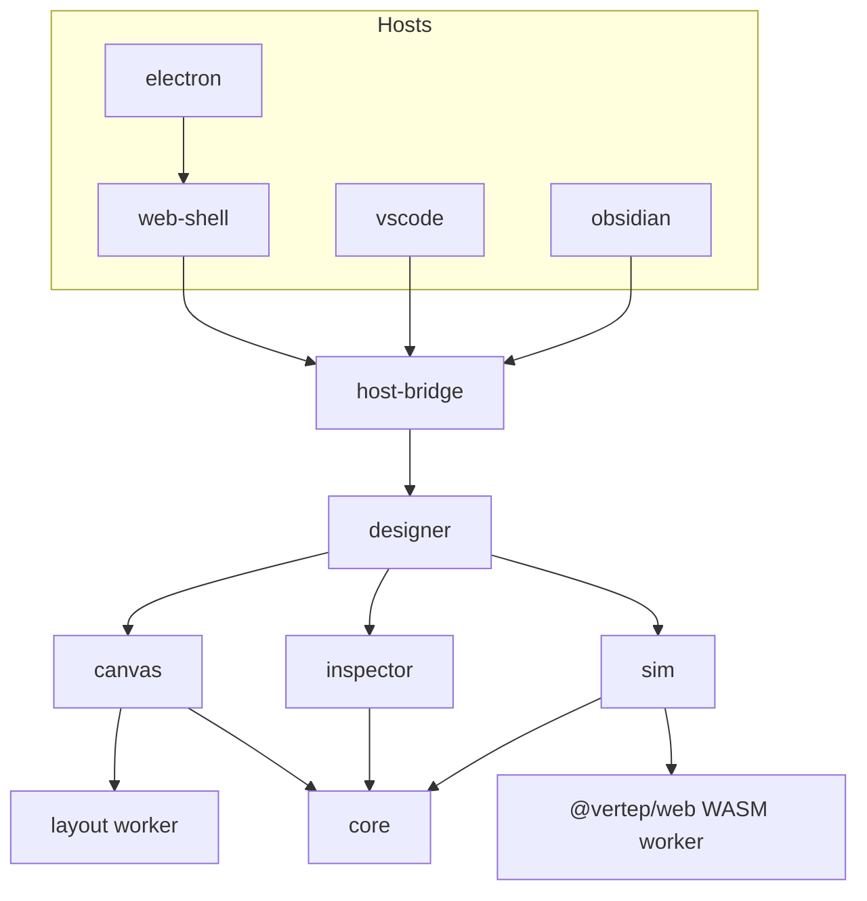
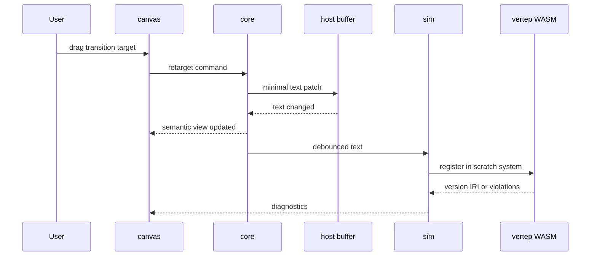
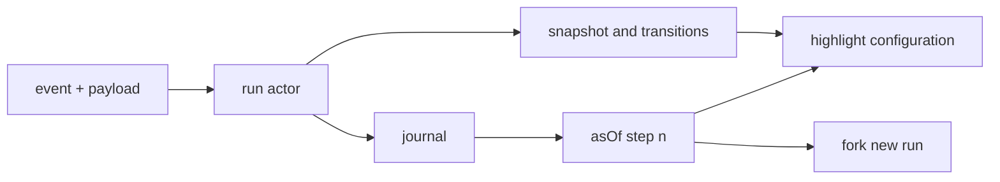

# Architecture View

How vertepnyk is put together: one host-independent designer over a format-preserving document model and vertep's WebAssembly interpreter, mounted by four thin hosts.

- describes:: [[components#core]]
- describes:: [[components#sim]]
- describes:: [[components#designer]]
- describes:: [[components#host-bridge]]
- describes:: [[decisions#The text file is the source of truth]]
- describes:: [[decisions#vertep WASM is the only interpreter]]
- describes:: [[decisions#Hosts are thin adapters over one core]]

## Packages and hosts

Hosts mount `designer` through the host bridge; the designer composes canvas, inspector and sim over core; sim is the only package that talks to vertep.

## One edit, end to end

A visual edit becomes a text patch the host applies; the new text flows back as the single source of truth to every view and to vertep.

## Simulation and time travel

A run is an actor in a volatile vertep system with a journal; the canvas renders snapshots, and time travel reads earlier snapshots with `asOf`.

